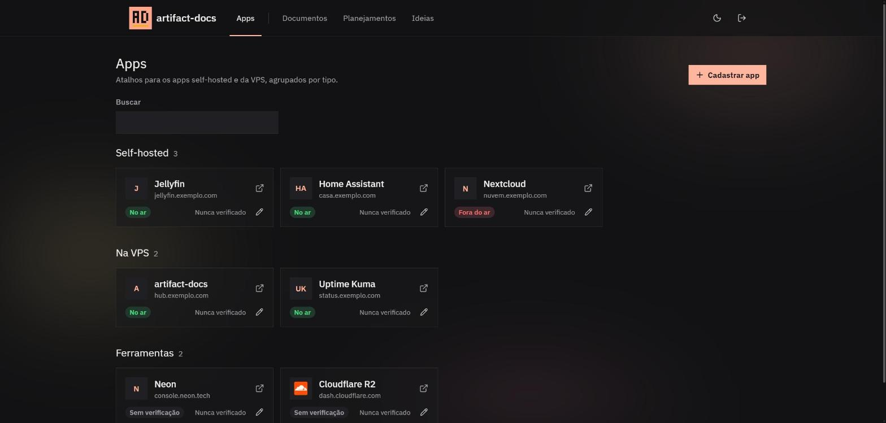
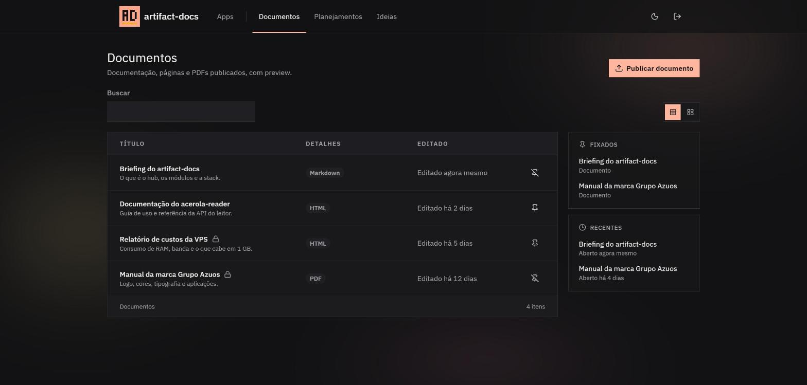
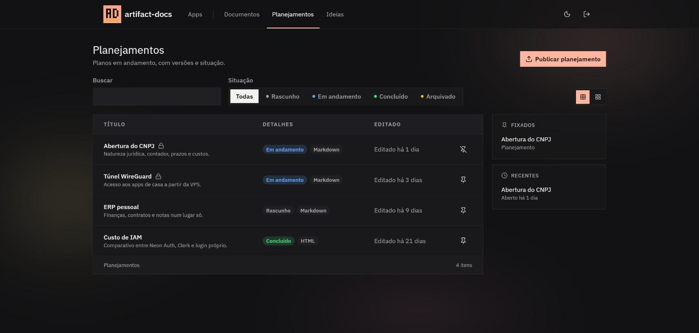
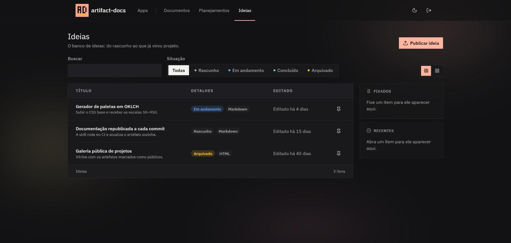

<p align="center">
  
</p>

<h1 align="center">artifact-docs</h1>

<p align="center"><strong>Hub pessoal num lugar só.</strong></p>

<p align="center">
  
</p>

Documentação de projetos, artefatos HTML/MD/PDF com galeria e preview, planejamentos, banco de
ideias, hub de apps e casa da marca. O que é e como funciona está no
[briefing](./docs/briefing.md).

## O que tem dentro

| Tela | O que faz |
| --- | --- |
| **Apps** | Atalhos para os apps self-hosted e da VPS, agrupados por tipo, com a situação de cada um |
| **Documentos** | Documentação, páginas e PDFs publicados, com preview, fixados e recentes |
| **Planejamentos** | Planos em andamento, com versões e situação |
| **Ideias** | O banco de ideias, do rascunho ao que já virou projeto |

<table>
  <tr>
    <td width="50%"></td>
    <td width="50%"></td>
  </tr>
  <tr>
    <td align="center"><sub>Documentos</sub></td>
    <td align="center"><sub>Planejamentos</sub></td>
  </tr>
  <tr>
    <td width="50%"></td>
    <td></td>
  </tr>
  <tr>
    <td align="center"><sub>Ideias</sub></td>
    <td></td>
  </tr>
</table>

## Rodando

Precisa só do [mise](https://mise.jdx.dev):

```bash
mise install       # Node, Go e golangci-lint nas versões do projeto
mise run setup     # hooks do git, Git-Flow e dependências do front
mise run dev       # API Go em :3010 e a tela em http://localhost:5010
```

`mise tasks` lista todos os comandos. `mise run check` é o que precisa passar antes de juntar
qualquer coisa na `develop`.

## Estrutura

| Pasta | O quê |
|---|---|
| `artifact-docs/` | O app: `svelte/` (SPA SvelteKit, `adapter-static`, infra do ticket-os), `src-go/` (backend Go) e `main.go`, que sobe o processo e embute a SPA. |
| `docs/` | Briefing, decisões e prints. |
| `.claude/` | Skills e hooks do Claude Code. |

Em produção é **um binário só** (`mise run build` → `artifact-docs/bin/artifact-docs`), com a tela embutida:
sem Node no servidor.

## Contribuindo

As regras de código, commit e branch estão no [CONTRIBUTING](./CONTRIBUTING.md). Toda mudança
nasce numa `feature/` a partir da `develop`.
